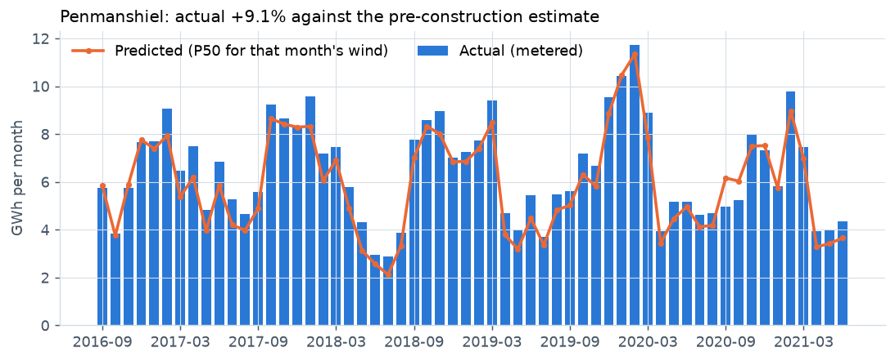
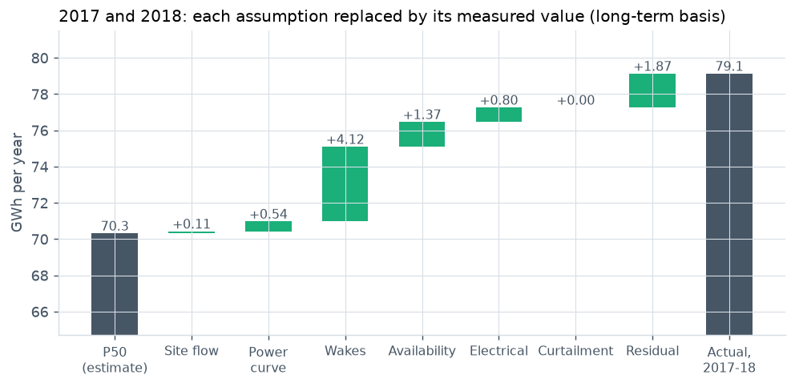
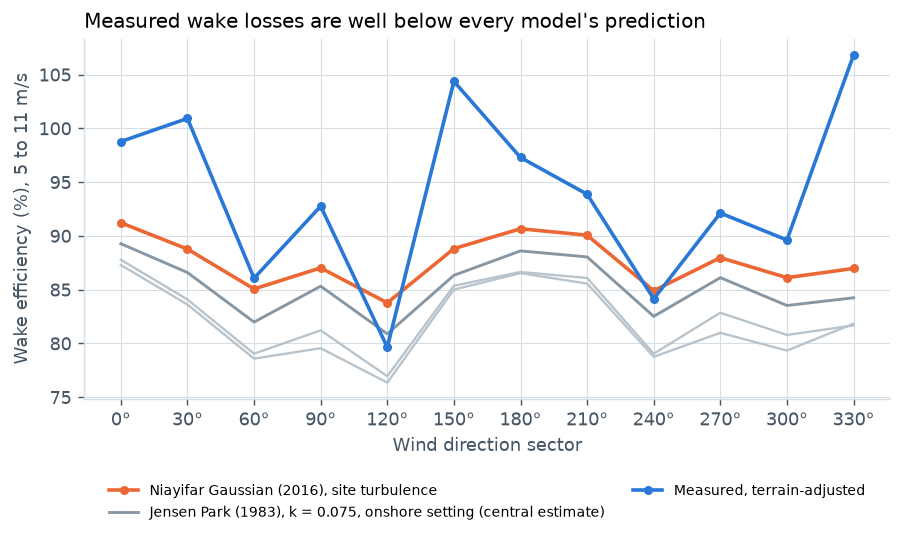
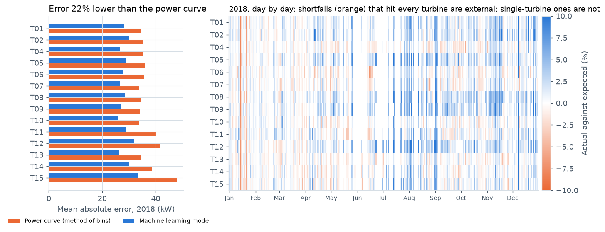
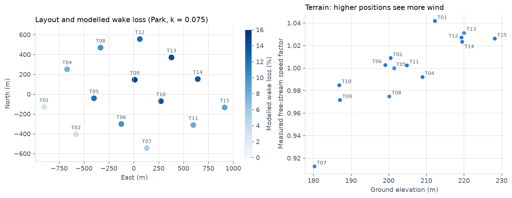
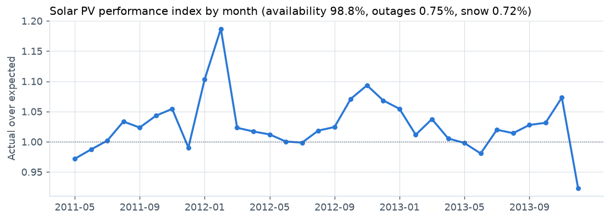

# Wind and solar energy assessment

A pre-construction style energy yield assessment for the **Penmanshiel wind farm** (14 Senvion MM82 turbines, 28.7 MW, Scottish Borders), tested against 58 months of metered production, with the gap between predicted and actual traced cause by cause. A **machine learning** model of each turbine's normal behaviour then flags underperformance, and a separate solar module reviews the performance of a monitored **solar PV system** on a different site: NREL PVDAQ system 50 in Golden, Colorado (Penmanshiel has no solar).

**[Open the interactive dashboard](https://onyichuks.github.io/wind-solar-energy-assessment/)** to try other assumptions (long-term method, wake model, availability, electrical, turbine performance and environmental losses) and watch the P50, P values and gap analysis update; pick any turbine for its details; filter the monthly comparison by period; set the turbine health threshold and see which days are flagged; and explore the solar results by year and by example day.

A one-page **[executive summary](docs/EXECUTIVE_SUMMARY.md)** gives the findings and what they mean. The full research-style write-up (abstract, objectives, data, methods, results, discussion, conclusions, limitations and references) is in **[docs/REPORT.md](docs/REPORT.md)**. The datasets, and every data issue found, are described in [docs/DATASET.md](docs/DATASET.md). The machine learning is examined in more depth in a **[machine learning technical note](docs/ML_TECHNICAL_NOTE.md)**: training curves, how much data the model needs, a linear baseline, where the errors are, and a fault injection test of how small a shortfall it can detect.



## Objective

Pre-construction energy yield assessments decide whether wind farms are financed, but they are rarely checked against what the farm later produces. This project asks:

1. What would a pre-construction style assessment have predicted, using only information available before construction?
2. How did actual production compare, and was the difference within the stated uncertainty?
3. Which assumptions explain the difference, measured from turbine SCADA?
4. Can a machine learning normal-behaviour model predict each turbine's power better than a power curve, and does it pick out underperformance worth investigating?
5. How well would an independent, pre-construction style estimate have predicted a monitored solar PV system's energy (NREL, Golden, Colorado), and where was energy lost?

## Key results

| Measure | Result |
|---|---|
| Long-term hub-height wind | 7.25 m/s, from a 12-month virtual met mast corrected to 25 years of ERA5 |
| Pre-construction estimate | **P50 70.3 GWh per year** (28.0 percent capacity factor); P90 61.0 GWh (10-year), 58.9 GWh (1-year) |
| Actual production | 375.5 GWh over 58 complete months, **9.1 percent above** the estimate for the same weather; long-term 76.7 GWh per year (about the P18 level) |
| Gap explained (2017 and 2018, with turbine SCADA) | Actual 12.5 percent above prediction; measured losses explain 79 percent of it. Largest item: wake losses of about **4.5 percent against 9.8 percent modelled** (47 percent of the gap) |
| Other measured items | Availability 97.8 percent against 96.0 percent assumed; electrical losses 1.0 percent against 2.0 percent; power curve and turbine performance 0.4 percent against 1.2 percent; no curtailment; unexplained 2.7 percent of the P50 |
| After 2018 | 7.6 percent above the estimate; the meters show the whole farm off for 14 days in autumn 2020 (roughly 2,500 MWh lost) |
| Machine learning turbine health | Gradient-boosted model per turbine, chosen over random forest, extra trees, a neural network, k-nearest neighbours and spline regression by cross-validation within 2017, then tested on 2018: mean absolute error **22 percent lower** than each turbine's power curve (28.6 kW against 36.8 kW), and the spread of daily results nearly halved (2.7 against 5.0 percent). At a 5 percent threshold it flags two farm-wide days (one an external power limit in the status logs) and five single-turbine events, led by T06, about 3 percent short through June 2018 |
| Terrain | The windiest turbine position sees 14 percent more wind than the calmest, tracking elevation; turbine-level predictions were out by -16 to +16 percent (about -10 to +10 percent after the terrain factors) |
| Long-term method check | Fitting on one measured year and predicting the other: -2.1 and -0.6 percent energy error for the method used, against +2.5 to +8.5 percent for hourly regression methods. A machine learning correction (gradient boosting) was as accurate (-0.6 and -1.0 percent) and gives almost the same P50 (70.6 GWh) |
| Solar PV (NREL system, Golden, Colorado) | An independent estimate from the rated size, generic PVWatts losses, ageing and long-term irradiance (P50 4,228 kWh per year) was **20.6 percent below** actual production in 2012 and 2013, beyond its uncertainty. The satellite irradiance was within 1.5 percent of NREL's on-site sensor, so the generic losses and ageing were too cautious (71 percent of rated output assumed, 86 percent achieved). Daylight availability 98.8 percent, outage loss 0.75 percent, suspected snow loss 0.72 percent, no material clipping |

| What explains the gap (2017 and 2018) | Wake losses: measured against modelled |
|---|---|
|  |  |





## Conclusions

1. **The estimate was conservative, not wrong.** The farm beat the P50 by 9.1 percent, inside the estimate's own uncertainty (about the P18 level).
2. **Wakes were the largest error.** Even the classic onshore Park setting over-predicted wake losses by about 2.7 times its assumed uncertainty; calibrating wake settings on operating wind farms would remove the largest error.
3. **Generic loss assumptions were conservative.** Availability, electrical losses and the power curve were all better than assumed for this turbine and connection. The same held for solar: with the irradiance right, generic PV losses and ageing put an independent estimate 20.6 percent below the Colorado system's production.
4. **Flow matters at turbine level.** Terrain hardly changed the farm total, but turbine positions see free-stream winds up to 14 percent apart, which layout work and turbine warranties need a flow model to capture.
5. **Machine learning narrows what counts as normal.** A normal-behaviour model beats a power curve on an unseen year and halves the noise in daily results, so smaller shortfalls stand out; splitting farm-wide from single-turbine shortfalls sends each to the right people. Its flags are candidates for inspection: the status logs do not explain the single-turbine events.
6. **Data checks change results.** A corrupt meter day, a stuck vane, a meter counter gap and a two-week outage would each have distorted a loss figure if left in.

## What the analysis does

**Data checks**

Downloads are verified against the checksums published with the data. Every dataset is checked for gaps, duplicates, clock problems, out-of-range and frozen readings, and the meters are checked against each other and against the summed turbine meters.

**Wind: pre-construction style estimate**
1. **Virtual met mast.** The nacelle anemometers of turbines with no neighbour upwind (IEC 61400-12-1 Annex A sectors) stand in for an on-site mast; calendar 2017 is the 12-month campaign.
2. **Long-term correction.** Sector-wise measure-correlate-predict against 25 years of ERA5, keeping the measured distribution shape; four methods compared by cross-validation between the two measured years, including a machine learning method (gradient-boosted trees on ERA5 wind, direction, shear, temperature, time of day and season).
3. **Energy and wakes.** MM82 power curve adjusted to site air density; four engineering wake models in DTU's PyWake on the real layout (Jensen Park with the onshore setting as the central case, Bastankhah Gaussian, and TurbOPark and Niayifar with turbulence measured on the nacelle anemometers).
4. **Losses and uncertainty.** Loss chain with typical pre-construction assumptions; uncertainty budget combined by root sum of squares with the modelled sensitivity ratio; P50, P75, P90 and P99 for 1, 10 and 20 years.

**Wind: predicted against actual**

5. **Month by month.** The P50 turned into a monthly prediction with an ERA5 energy index and compared with the revenue meter for 58 months.
6. **Measured losses.** Availability, electrical losses, power curve, terrain speed-up and wake losses from 2017 and 2018 turbine SCADA; curtailment from the operator's turbine records.
7. **Gap waterfall.** For 2017 and 2018, each assumption replaced by its measured value until only the residual is left.

**Wind: turbine health (machine learning)**

8. **Normal-behaviour model.** One gradient-boosted tree model per turbine (scikit-learn), chosen over five other model types by cross-validation within 2017, learns expected power from nacelle wind speed, turbulence, wind direction, and ERA5 air temperature and density, trained on healthy 2017 data and tested on 2018 against each turbine's own power curve.
9. **Monitoring.** Daily actual against expected energy below the 25 m/s cut-out; days more than 5 percent short are flagged, split into farm-wide days (external causes) and single-turbine events, and checked against the turbine status logs and the operator's performance-loss records.

**Solar (NREL PVDAQ system 50, Golden, Colorado)**

10. **Data checks.** Daylight saving clock shifts found with PVAnalytics and corrected; missing, negative and stale values removed.
11. **Expected energy.** pvlib model from satellite irradiance (Erbs, Perez, SAPM temperature, PVWatts); DC capacity fitted on clear-sky periods.
12. **Losses.** Outages, suspected snow cover and clipping separated from the remaining performance gap.
13. **Independent estimate.** Rated size from NREL's metadata, generic PVWatts losses, 0.5 percent a year ageing and satellite irradiance corrected to 25 years of ERA5, made without the measured output; tested against 2012 and 2013, with the irradiance checked against NREL's on-site sensor.



## Run it yourself

Python 3.10 or later (tested with Python 3.11, pandas 2.3, scikit-learn 1.6, PyWake 2.6, pvlib 0.16 and PVAnalytics 0.2). On Windows, use `py` instead of `python` if that is how Python is installed.

```bash
pip install -r requirements.txt
python scripts/get_data.py          # downloads about 1.06 GB of open data into ./data/raw
python scripts/prepare_data.py      # keeps the signals used and writes compact Parquet files
python scripts/check_data.py        # data quality checks: tables to ./outputs/tables/q*, summary in outputs/data_quality.json
python run_wind.py                  # wind assessment (about a minute): tables to ./outputs/tables, summary in outputs/wind_results.json
python run_health.py                # machine learning turbine health: tables h01 to h06, summary in outputs/health_results.json
python scripts/compare_models.py    # optional: compares six machine learning models (tables h07 and h08; about 25 minutes)
python run_ml_analysis.py           # optional: the machine learning technical note (tables m01 to m04; about 30 minutes)
python run_solar.py                 # solar assessment: outputs/solar_results.json
python scripts/make_figures.py      # figures for this README
python scripts/make_ml_figures.py   # figures for the machine learning technical note
python scripts/build_dashboard.py   # interactive dashboard in ./docs/index.html
python -m pytest                    # unit tests (no data needed)
```

For the solar module alone: `python scripts/get_data.py --solar` then `python run_solar.py`.

The wind and solar outputs reproduce exactly, apart from the machine learning long-term check, which moves slightly with the scikit-learn version (its P50 by 0.2 percent between 1.6 and 1.9; the central case does not use it). The turbine health results vary slightly with the scikit-learn version (checked with 1.6 and 1.9: the same days and events are flagged, the headline accuracy figures agree to within 0.1, and individual event shortfalls to within about 0.3 percentage points).

## Repository layout

```
src/energyassess/      analysis package
  resource.py          reanalysis loading, air density, shear, measure-correlate-predict, Weibull, frequency tables
  turbine.py           power curve, density adjustment, thrust curve
  wakes.py             PyWake layout, wake models, energy from frequency tables
  eya.py               loss chain, uncertainty, P values
  scada.py             loading the Greenbyte turbine, status and meter exports
  operational.py       data checks, undisturbed sectors, virtual mast, losses, terrain, measured wakes
  health.py            machine learning normal-behaviour model, daily residuals, underperformance flags
  solar.py             clock shift detection, expected PV power, losses, performance ratio
  outputs.py           strict JSON output
run_wind.py            wind assessment and predicted-against-actual comparison
run_health.py          turbine health model, test and monitoring
run_ml_analysis.py     machine learning checks: training and learning curves, baselines, error breakdown, fault injection
run_solar.py           solar performance review
scripts/               data download and preparation, data quality checks, model comparison, figures, dashboard build
static_data/           turbine table and MM82 reference power curve
dashboard/             dashboard template (HTML and JavaScript)
docs/                  published dashboard (GitHub Pages), executive summary, research report, machine learning note, dataset guide
outputs/               result tables and JSON summaries
figures/               figures used in this README
tests/                 unit tests on synthetic data
```

## Data and licences

Contains Penmanshiel wind farm data published by Cubico Sustainable Investments on Zenodo (record 5946808) under CC BY 4.0; ERA5 reanalysis data from the Copernicus Climate Change Service, accessed through the Open-Meteo historical weather API; and NREL PVDAQ system 50 data as packaged in the PVAnalytics example data. The MM82 power curve is from the renewables.ninja virtual wind farm library (BSD 3-Clause). The data are downloaded by `scripts/get_data.py` and are not stored in this repository.

Code is released under the MIT licence.

## Author

Onyi Chuks, Calgary, Alberta.
