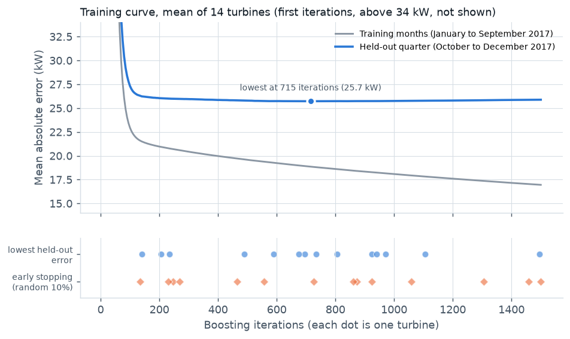
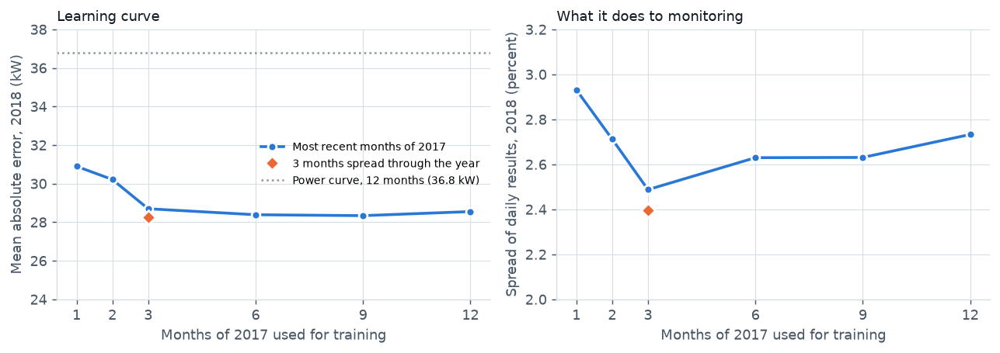
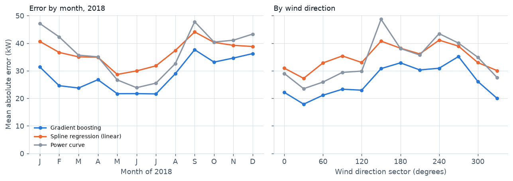
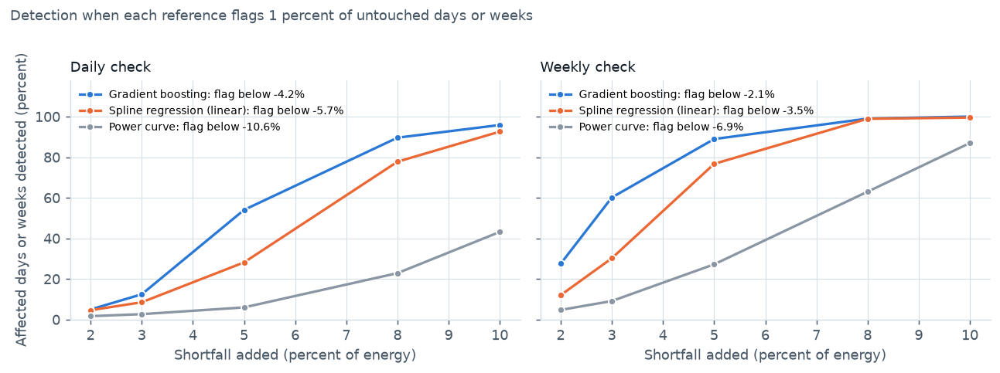

# Machine learning technical note: turbine normal-behaviour model

Onyi Chuks, Calgary, Alberta. October 2026. [Interactive dashboard](https://onyichuks.github.io/wind-solar-energy-assessment/) · [Research report](REPORT.md) · [Executive summary](EXECUTIVE_SUMMARY.md) · [Code](https://github.com/onyichuks/wind-solar-energy-assessment)

## 1. Summary

This note goes behind the machine learning in the [research report](REPORT.md): how the turbine normal-behaviour model was trained and checked, whether it earns its place against simpler references, and how small a shortfall it can detect. The new results come from `run_ml_analysis.py` and are stored in `outputs/ml_results.json` and `outputs/tables/m01` to `m04`; the six-model comparison, the monthly residuals and the long-term wind figures are taken from the research report's outputs (`health_results.json` and tables `h05`, `h07`, `w04` and `w17`).

* **Simpler references.** On 2018, a year the model never saw, gradient boosting's mean absolute error is **22 percent lower** than both a linear spline model and each turbine's own power curve (28.55 against 36.47 and 36.78 kW).
* **Detection.** Known shortfalls were added to the 2018 data, with each reference set to flag 1 percent of healthy weeks. A weekly check then catches a **5 percent shortfall 89 percent of the time** with the model, against 77 percent with the linear model and 27 percent with the power curve.
* **Training data.** Beyond about three months of data, more did not help in this test, and three months spread through the year did as well as the full year. Even one month of data beats a full-year power curve.
* **Training behaviour.** Accuracy is flat from about 400 to 1,500 iterations. Early stopping on a random 10 percent of the training data stops at very different points from turbine to turbine; against each turbine's best point it cost 1.4 percent in accuracy on average and 8.5 percent at worst. A fixed 1,500 iterations, set in advance, cost 1.1 and 3.4 percent.
* **Weak spots.** Above 15 m/s the power curve is more accurate than the model, and actual production runs 0.87 percent above the model's expected energy, mostly in summer. Section 12 sets out fixes for both.

The project uses machine learning in a second place, the long-term wind correction, covered briefly in section 11. The solar module uses physical models and statistical change-point detection rather than machine learning, so it is not covered here.

## 2. Problem set-up

| | Turbine normal-behaviour model |
|---|---|
| Target | Power of one turbine in each 10-minute interval (kW) |
| Inputs | Nacelle wind speed, turbulence intensity (standard deviation over mean wind speed), wind direction (sine and cosine), and ERA5 air temperature and air density |
| One model per turbine | 14 models |
| Training | 2017, normal operation only (valid data, no recorded downtime), after a robust filter that drops points more than four scaled median absolute deviations from the median power of their 0.5 m/s wind speed bin (0.3 percent of points) |
| Test | 2018, scored once |
| Used for | Daily actual against expected energy per turbine, flagged when more than 5 percent short |

**Leakage and drift controls.**
* Air temperature comes from ERA5, not the nacelle sensor, because the nacelle signal is missing for weeks of 2018 but never in 2017. Both `run_health.py` and `run_ml_analysis.py` refuse to score a test set with clearly more missing inputs than its training set.
* At or above the 25 m/s cut-out, expected power is set to zero. One year of training data holds too few storm intervals for the trees to learn this designed stop.
* 2018 was not used to tune the model's settings. It did shape two fixes: reviewing the first version on 2018 showed that a temperature signal missing only in 2018, and storm shutdowns above cut-out, were creating false shortfalls, which led to the ERA5 temperature input and the cut-out rule (section 5 of the report). The training curves in section 5 use a held-out quarter of 2017. The learning curve, error breakdown, residual check and fault test (sections 6 to 10) are computed on 2018, but only to describe the chosen model; nothing was changed because of them.

## 3. Models

**Gradient-boosted trees (used).** A normal-behaviour model in the sense of Schlechtingen and Santos (2011): it learns healthy output from the conditions, so that a shortfall stands out. It uses scikit-learn's histogram gradient boosting (Friedman, 2001; Pedregosa et al., 2011) with the squared error loss:

| Setting | Value |
|---|---|
| Learning rate | 0.05 |
| Maximum iterations | 1,500 |
| Maximum leaves per tree | 31 |
| Minimum intervals per leaf | 40 |
| L2 regularization | 1.0 |
| Early stopping | A random 10 percent of the training intervals is held out; training stops after 20 rounds without improvement |

**How it was chosen.** Six machine learning models with standard settings fixed in advance were compared by blocked cross-validation inside 2017: each calendar quarter held out in turn, scored by mean absolute error (`scripts/compare_models.py`). Gradient boosting had the lowest error on all 14 turbines. The full table is in section 4.5 of the [research report](REPORT.md).

**Two simpler references.**
* **Spline regression (linear).** Cubic splines with 12 knots on each input, then ridge regression. It is linear in its parameters, so it can follow the curved power curve but cannot learn interactions between inputs, such as turbulence mattering more near rated wind speed.
* **Power curve.** Each turbine's own power curve by the method of bins (mean power per 0.5 m/s, after IEC 61400-12-1 but without its air density correction), built from the same filtered 2017 data. Comparing actual power with a power curve is the common baseline in SCADA performance monitoring (Tautz-Weinert and Watson, 2017).

## 4. Validation design

* **Choosing the model:** blocked cross-validation by quarter inside 2017 (section 3).
* **Training behaviour:** each turbine's model is retrained on January to September 2017 with early stopping switched off, and scored on October to December 2017 at every 5th iteration.
* **Final test:** fit on all of 2017, score on 2018.
* **Scores:** mean absolute error and root mean square error of 10-minute power, energy bias, and the spread (standard deviation) of daily and weekly actual against expected energy, which is what decides how small a shortfall can be seen.

## 5. Training behaviour



* **The number of iterations hardly matters once past about 400.** Averaged over the 14 turbines, the held-out error is lowest at 715 iterations (25.7 kW) and stays within 0.7 percent of that from 400 to 1,500 iterations. The training error keeps falling, from 20.0 kW at 400 iterations to 17.0 kW at 1,500. That growing gap is detail that does not carry to new data, but it does little harm.
* **Early stopping on a random 10 percent is erratic.** On the same January to September data, it stopped anywhere from 135 to 1,500 iterations, and the turbines' own held-out optimum was just as spread (140 to 1,495). For most turbines the two were hundreds of iterations apart.
* **The cost is small but not zero.** Each early-stopped model was scored on the held-out quarter as it stands (it is also trained on only 90 percent of the January to September data, which is part of the cost). Against the lowest error on each turbine's curve, it was 1.4 percent worse on average (median 1.2 percent), and slightly better on three turbines. The worst case was T04, which stopped at 135 iterations against a best of 675 and was 8.5 percent worse (26.0 against 23.9 kW).
* **A fixed number of iterations did better.** Simply running all 1,500 iterations, a number set in advance, was 1.1 percent worse than each turbine's best on average (median 0.8 percent) and 3.4 percent at worst (T07).
* **Why early stopping is erratic:** probably because the curve is so flat that small differences decide where it stops, and a random hold-out of correlated 10-minute data (section 9) is a noisy guide to a new month. A time-blocked hold-out (Roberts et al., 2017) has not been tested here; both options are listed in section 12.

## 6. How much training data the model needs



Each turbine's model was retrained on parts of 2017 and tested on all of 2018.

| Training data from 2017 | Intervals per turbine | Mean absolute error, 2018 (kW) | Spread of daily results, 2018 |
|---|---|---|---|
| Last month (December) | 4,384 | 30.9 | 2.93% |
| Last 2 months | 8,644 | 30.2 | 2.71% |
| Last 3 months | 13,040 | 28.7 | 2.49% |
| 3 months spread through the year (February, June, October) | 12,558 | **28.3** | **2.40%** |
| Last 6 months | 26,171 | 28.4 | 2.63% |
| Last 9 months | 38,999 | 28.3 | 2.63% |
| **All 12 months (used)** | **51,711** | **28.55** | **2.73%** |
| Power curve, all 12 months | | 36.8 | see section 7 |

(Mean absolute error is the mean over the 14 turbines. The daily spread is over the 3,608 turbine-days assessed under all seven training sets, a slightly different set of days from section 7, so the full-year model's spread is 2.73 percent here and 2.71 percent there.)

* **Even one month of data beats a full-year power curve** (30.9 against 36.8 kW), because the model uses turbulence, direction and temperature as well as wind speed.
* **Beyond about three months, more data does not help.** Every training set from three months upwards scores between 28.3 and 28.7 kW.
* **Three months spread through the year did as well as any longer set** in this test, on both accuracy and daily spread, and one month of December data alone was the weakest. That points to seasonal coverage mattering, but the evidence is thin: the last three months of the year, a single season, also had a tighter daily spread (2.49 percent) than six, nine or twelve months.
* These differences between three and twelve months are small (under 0.5 kW and 0.35 points of spread). They come from the test year and are of the same size as the variation from early stopping (section 5), so the model was not changed because of them. Whether a shorter, season-spread training set really helps is worth testing by cross-validation within the training year.

## 7. Against simpler models

| 2018 | Mean absolute error (kW) | Root mean square error (kW) | Energy: actual against expected | Spread of daily results | Spread of weekly results |
|---|---|---|---|---|---|
| **Gradient boosting (used)** | **28.55** | **50.37** | +0.87% | **2.71%** | **1.65%** |
| Spline regression (linear) | 36.47 | 53.05 | +0.52% | 2.98% | 1.85% |
| Power curve | 36.78 | 59.40 | +0.25% | 4.97% | 3.20% |

(The first three columns are means over the 14 turbines. The spreads are standard deviations over the 3,583 turbine-days, and 642 turbine-weeks, assessed under all three references.)

* Gradient boosting's mean absolute error is 22 percent lower than both the linear spline model and the power curve. Its root mean square error is 15 percent lower than the power curve's and 5 percent lower than the spline model's.
* **The linear model sits in between.** Its mean absolute error is barely better than the power curve's, but it has fewer large misses and a much tighter daily spread (2.98 against 4.97 percent), because it also uses turbulence, direction and temperature. It cannot learn how they interact with wind speed, which is where the trees gain.
* **On total energy the simpler references are closer.** The turbines produced 0.87 percent more than the model expected, against 0.25 percent more than the power curves expected, mostly in July and August (section 4.5 of the report). For monitoring, the spread of daily and weekly results matters more than this small offset. The offset is mostly seasonal: monthly residuals are near zero from January to March and up to +5 percent per turbine in July and August, with all but one of those turbine-months above +0.5 percent (table `h05`, from `run_health.py`), which a seasonal correction or monthly thresholds can allow for (section 12).
* The other machine learning models (random forest, extra trees, a neural network and k-nearest neighbours) are compared in section 4.5 of the research report. Random forest and the neural network had lower root mean square error on 2018 (46.6 and 46.8 against 50.4 kW), so averaging models is listed in section 12.

## 8. Where the errors are



**By wind speed** (all turbines' 2018 intervals together):

| Nacelle wind speed (m/s) | Intervals | Mean power (kW) | Gradient boosting | Spline (linear) | Power curve |
|---|---|---|---|---|---|
| 0 to 3 | 91,689 | about 0 | 2.3 | 18.2 | **0.6** |
| 3 to 6 | 245,124 | 122 | **18.6** | 27.2 | 19.3 |
| 6 to 9 | 208,233 | 635 | **39.6** | 41.0 | 50.4 |
| 9 to 12 | 96,884 | 1,468 | **50.2** | 63.2 | 80.4 |
| 12 to 15 | 46,922 | 1,955 | **31.9** | 47.1 | 57.4 |
| 15 to 25 | 32,724 | 2,027 | 36.8 | 33.3 | **23.1** |
| 25 and above (cut-out) | 242 | 111 | **116.3** | **116.3** | 148.9 |

(Mean absolute error, kW. Above 25 m/s both models are set to zero by the cut-out rule.)

* The model gains most between 6 and 15 m/s, on the steep part of the power curve, where turbulence and air density change the output most.
* **Above 15 m/s it is worse than the power curve.** Near rated power the curve is flat and its bin average is hard to beat, and one year holds few storm hours for the trees to learn from. Using the power curve above 15 m/s is a simple fix (section 12).
* Below 3 m/s the errors are trivial in energy. The linear model does poorly there, most likely because its additive spline terms cannot hold power at zero while turbulence and temperature vary.

**By month:** the model is the most accurate reference in all twelve months. The gain is largest in late winter (February 24.6 against 42.3 kW for the power curve, 42 percent lower) and smallest in early summer (June 21.7 against 23.9 kW), when winds are light. September, which included Storm Ali, has the highest error (37.7 kW).

**By wind direction:** the largest gains are in the 150 and 240 degree sectors, where the model's error is 37 and 29 percent below the power curve's (30.8 against 48.7 kW, and 30.9 against 43.5 kW). A single power curve per turbine cannot represent effects that depend on direction, such as wakes from neighbouring turbines and the terrain upwind. The model likely captures them partly through the direction inputs and partly through turbulence, which is higher in wakes; direction itself carries only 0.5 percent of the permutation importance (report section 4.5).

**By turbulence:** the model's advantage is largest in low-turbulence air (below 6 percent: 17.0 against 28.2 kW; 6 to 9 percent: 27.1 against 46.1 kW) and again above 20 percent (18.6 against 27.9 kW). A power curve averages over all turbulence levels, so it cannot follow how output changes with turbulence at the same wind speed.

**By hour of day:** the model's error stays between 26.5 and 31.1 kW through the day. Its advantage over the power curve is largest in the early afternoon (about 0.71 of the power curve's error from 1 to 5 pm, against 0.79 to 0.85 between midnight and 6 am), consistent with turbulence from daytime heating, which the model sees and the power curve does not.

## 9. Residuals

The model's 10-minute errors are clearly linked to the errors just before them, but hardly at all to the same time on the previous day:

| Lag | Correlation of errors |
|---|---|
| 10 minutes | 0.44 |
| 1 hour | 0.27 |
| 1 day | 0.03 |

This explains two things.
* **Why random validation splits can be optimistic** for 10-minute SCADA data: a randomly held-out interval is correlated with its neighbours in the training set, so it is not a fully independent test (section 5). This was not measured directly here.
* **Why daily and weekly checks work:** errors partly cancel within a day, so a daily total is far steadier than a 10-minute value, and a week steadier again: the spread of weekly results (1.65 percent) is narrower than the daily spread (2.71 percent). It is not as narrow as fully independent days would give (about 1.15 percent for the average of 5.6 assessed days a week), because some offsets persist for weeks, such as the summer offset and T06 in June 2018. A weekly check can still see smaller shortfalls than a daily one (section 10).

## 10. Fault injection test

The real 2018 data has few confirmed faults, so known shortfalls were added to it. For 8 randomly chosen weeks on each turbine (112 turbine-weeks), actual energy was reduced by 2, 3, 5, 8 or 10 percent on every assessed day. The draw was repeated 20 times and the results averaged. All three references are scored on the same 3,583 turbine-days. A uniform shortfall is a simplification: real faults such as pitch or yaw errors depend on wind speed. But it measures what decides an alarm, which is how far healthy days scatter.

**At the rule used in the report** (flag a day more than 5 percent short):

| | Gradient boosting | Spline (linear) | Power curve |
|---|---|---|---|
| Untouched turbine-days flagged | **0.8%** | 2.0% | 11.4% |
| Weeks with a 3% shortfall where at least one day is flagged | 24.6% | 45.2% | 62.4% |
| Weeks with a 5% shortfall where at least one day is flagged | 72.4% | 81.1% | 82.9% |
| Weeks with an 8% shortfall where at least one day is flagged | 98.8% | 99.3% | 98.8% |

At a fixed rule the power curve seems to catch more, but only because it also flags about one healthy day in nine, so many of its catches would have happened with no fault at all.

**At an equal false alarm rate.** A fair comparison sets each reference's threshold so that it flags exactly 1 percent of untouched days (or weeks), and then counts what it catches:



| Shortfall added | Daily check: boosted (flag below -4.2%) | Daily: spline (below -5.7%) | Daily: power curve (below -10.6%) | Weekly check: boosted (flag below -2.1%) | Weekly: spline (below -3.5%) | Weekly: power curve (below -6.9%) |
|---|---|---|---|---|---|---|
| 2% | 4.9% | 4.6% | 1.7% | 27.5% | 12.0% | 4.7% |
| 3% | 12.4% | 8.5% | 2.6% | **60.1%** | 30.2% | 9.1% |
| 5% | **54.0%** | 28.1% | 6.0% | **88.9%** | 76.7% | 27.2% |
| 8% | 89.6% | 77.8% | 22.9% | 99.0% | 98.9% | 63.0% |
| 10% | 95.9% | 92.6% | 43.2% | 100% | 99.5% | 87.0% |

(Share of affected days, or weeks, detected. The thresholds are averages over the 20 draws.)

* **With equal false alarms, the model sees far more.** A weekly check catches a 5 percent shortfall 89 percent of the time with the model, 77 percent with the spline model and 27 percent with the power curve. The smallest shortfall caught in at least 80 percent of weeks is 5 percent for the model, 8 percent for the spline model and 10 percent for the power curve.
* **A weekly check suits slow faults.** For a week-long 3 percent shortfall, the weekly check flags 60 percent of the affected weeks, while the daily check (at its own 1 percent false alarm threshold) flags at least one day in only 41 percent of them. A sensible set-up is a daily check for sudden faults and a weekly check for gradual ones such as blade soiling or a slowly drifting yaw offset. The thresholds above (about -4.2 percent a day and -2.1 percent a week for the model) are set on 2018 itself, so in practice they would be set again before use from out-of-fold residuals in the training year (blocked cross-validation by quarter, as in section 3); in-sample training residuals would scatter too little and give thresholds that are too tight.

## 11. Second use: long-term wind correction

The energy yield assessment needs the long-term wind at the site, built from one measured year and 25 years of ERA5 reanalysis. Four methods were compared by fitting on one year and predicting the other (section 4.2 of the research report); the last row of the table is a variant of the gradient-boosted one with fewer inputs. The gradient-boosted model predicts hourly site wind from ERA5 wind at 100 m and 10 m, direction, shear, temperature, pressure, time of day, season and the 100 m wind an hour either side.

| Method | Energy error, fit 2017, test 2018 | Energy error, fit 2018, test 2017 | Hourly R squared |
|---|---|---|---|
| Scaled measured distribution (used) | -2.1% | -0.6% | not applicable |
| Hourly linear regression, by sector | +2.5% | +6.2% | 0.83 and 0.80 |
| Hourly variance ratio, by sector | +4.5% | +8.5% | 0.83 and 0.79 |
| **Gradient boosting** | **-0.6%** | **-1.0%** | **0.86 and 0.84** |
| Gradient boosting, wind speed and direction only | -1.4% | -1.6% | 0.84 and 0.82 |

(Energy error, as defined in the report: mean power of one turbine from the reference power curve, without wakes, against the measured year.)

* The machine learning method gives the most accurate hourly series and an energy error within about 1 percent in both folds. The linear methods overstate energy because ERA5 is smoother than the site and a straight line per sector cannot follow the curved relationship at low wind speeds.
* With wind speed and direction alone it is already within 1.6 percent, so most of the gain comes from the curved fit rather than the extra inputs.
* Two folds cannot separate methods this close, so the central case stays with the scaled measured distribution, and the machine learning method is offered as an alternative in the dashboard. The long-term P50 differs by only 0.3 percent.

## 12. Limitations and next steps

* **One training year.** The model learns 2017 as normal, so a fault present all through 2017 would be invisible. Training on a rolling 12 months, or checking each turbine against its neighbours, would guard against that.
* **Early stopping:** fix the number of iterations, which cost less than early stopping in section 5 (1.1 against 1.4 percent on average, and 3.4 against 8.5 percent at worst), or try a time-blocked hold-out (for example the last month of the training data), which has not been tested.
* **Seasonal offset:** actual production runs above expected in summer (section 7). A monthly correction of expected energy, or thresholds set by season from the training year, would make the flags equally sensitive all year.
* **High winds:** use the power curve above 15 m/s, or learn storm behaviour from more years of data.
* **Averaging models:** random forest and the neural network make fewer large misses than gradient boosting (root mean square error about 7 percent lower on 2018); an average of the three, chosen by blocked cross-validation in the training year, may beat each alone.
* **Realistic faults:** inject shortfalls shaped like real faults to test detection more strictly. A pitch offset mainly cuts output below and near rated wind speed (above rated, the pitch controller compensates), and yaw misalignment reduces power roughly with the square to the cube of the cosine of the yaw error.
* **Thresholds by turbine and season:** the daily spread differs between turbines and months, so a threshold set from each turbine's own scatter would flag more evenly.
* **The anemometer problem:** the strongest input, nacelle wind speed, is measured behind the rotor of the turbine being judged. A model built on neighbouring turbines' wind would catch problems that disturb both power and the nacelle anemometer.

## 13. Reproducing

```
python scripts/get_data.py            # downloads the open data and checks the checksums
python scripts/prepare_data.py
python run_health.py                  # the turbine health model, as in the report
python run_ml_analysis.py             # this note (about 30 minutes on two processor cores)
python scripts/make_ml_figures.py     # figures 7 to 10
python -m pytest                      # unit tests, including tests/test_ml.py
```

The analysis was run with scikit-learn 1.6. Section 8 of the research report notes how the health results vary slightly with the scikit-learn version.

## References

* Friedman, J. H. (2001). Greedy function approximation: a gradient boosting machine. *Annals of Statistics*, 29(5), 1189 to 1232.
* IEC 61400-12-1:2017. Wind energy generation systems, Part 12-1: Power performance measurements of electricity producing wind turbines. International Electrotechnical Commission.
* Pedregosa, F. et al. (2011). Scikit-learn: machine learning in Python. *Journal of Machine Learning Research*, 12, 2825 to 2830.
* Plumley, C. (2022). *Penmanshiel Wind Farm Data* (version 0.0.2). Zenodo, record 5946808. Cubico Sustainable Investments.
* Roberts, D. R. et al. (2017). Cross-validation strategies for data with temporal, spatial, hierarchical, or phylogenetic structure. *Ecography*, 40(8), 913 to 929.
* Schlechtingen, M. and Santos, I. F. (2011). Comparative analysis of neural network and regression based condition monitoring approaches for wind turbine fault detection. *Mechanical Systems and Signal Processing*, 25(5), 1849 to 1875.
* Tautz-Weinert, J. and Watson, S. J. (2017). Using SCADA data for wind turbine condition monitoring: a review. *IET Renewable Power Generation*, 11(4), 382 to 394.

Data: Penmanshiel Wind Farm Data (Plumley, 2022; Cubico Sustainable Investments, CC BY 4.0) and ERA5 (Copernicus Climate Change Service) through Open-Meteo. Independent project.
